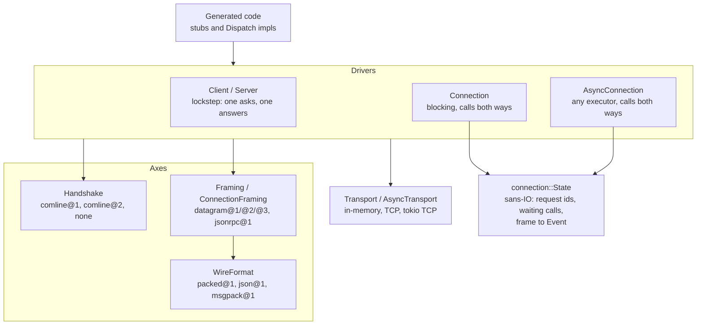
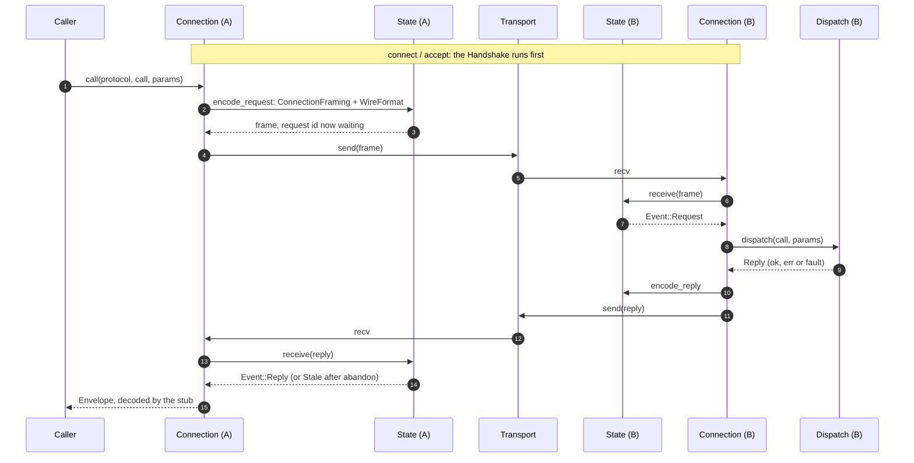
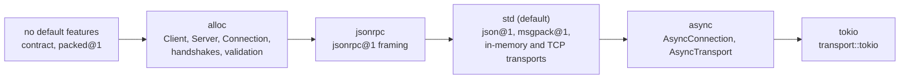

# Runtime architecture

How `comline-runtime` (`runtime/core`) is put together. The diagrams are
Mermaid, which GitHub renders in place.

## Layers

A call goes through four independent axes, each a trait with its own
implementations. Generated code picks one of each, as the schema declares.

- **`WireFormat`** (`contract`, implementations in `format`) serialises a
  call's parts: params, results, errors. `packed@1` needs neither `std` nor
  `alloc`.
- **Framing** wraps the parts into a frame. `Framing` is the lockstep shape
  that `Client` and `Server` use. `ConnectionFraming` frames say whether
  they are a request or a reply, so either end can call: `datagram@2`,
  `datagram@3`, and `jsonrpc@1` (which names only its method).
- **`Transport`** moves whole frames: `transport::{InMemory, Tcp}`, and with
  `async`, `AsyncTransport` (`AsyncInMemory`, `transport::tokio::Tcp`).
- **`Handshake`** runs once when a connection opens: `comline@1` (the same
  IR on both ends), `comline@2` (compatibility by lines and shape hashes,
  `handshake::comline2`), or `none`.
- **`connection::State`** is what both connection drivers share. It does
  no I/O: it encodes requests and replies, and turns a received frame into
  an `Event` (`Request`, `Reply` or `Stale`). The C ABI
  (`comline-runtime-ffi`) is built on it too.

## One call over a connection

While A waits for its reply, it keeps serving B's requests, so calls nest:
a handler can call back the peer that called it.

## Features

